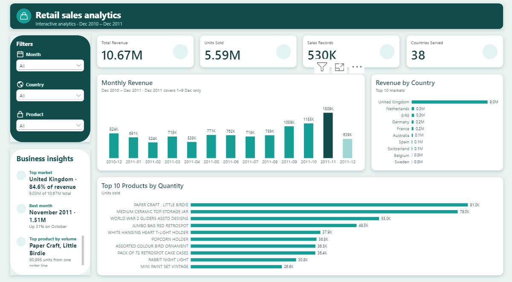

#  Retail Sales Analytics Dashboard | Power BI

##  Project Overview

This project presents an interactive **Retail Sales Analytics Dashboard** developed using Microsoft Power BI.

The dashboard provides insights into retail sales performance, revenue trends, product demand, and geographical sales distribution.

The main objective is to transform raw retail data into meaningful business insights through interactive data visualizations.

##  Dashboard Preview



## 📈 Key Performance Indicators

| KPI | Value |
|---|---|
|  Total Revenue | £10.67M |
|  Units Sold | 5.59M |
|  Sales Records | 530K |
|  Countries Served | 38 |

##  Dashboard Features

- **Monthly Revenue Analysis:** Visualizes monthly revenue trends.
- **Revenue by Country:** Identifies the top 10 markets by revenue.
- **Top 10 Products:** Highlights the best-selling products by quantity.
- **Interactive Slicers:** Filters data by Month, Country, and Product.
- **KPI Cards:** Displays key retail business metrics.
- **Business Insights:** Summarizes important findings from the sales data.

##  Key Business Insights

###  Top Revenue Market
The United Kingdom contributed approximately **84.6%** of total revenue, making it the leading market.

###  Highest Revenue Month
November 2011 recorded approximately **£1.51M** in revenue.

###  Top Product by Quantity
**Paper Craft, Little Birdie** recorded approximately **80,995 units** in the analyzed dataset.

## 🛠️ Tools and Technologies

- Microsoft Power BI
- Python
- Pandas
- Jupyter Notebook
- Microsoft Excel
- GitHub

##  Project Structure

```text
Retail-Sales-Analysis-powerbi/
│
├── Dashboard.png
├── Online Retail.ipynb
├── Online Retail.xlsx
├── retail_sales_dashboard.pbix
└── README.md
```

##  How to Use This Project

1. Download or clone this GitHub repository.
2. Open `retail_sales_dashboard.pbix` in Microsoft Power BI Desktop.
3. Explore the interactive KPI cards and visualizations.
4. Use the Month, Country, and Product slicers to filter the data.
5. Open `Online Retail.ipynb` in Jupyter Notebook to explore the Python notebook.

##  Project Objectives

- Analyze retail sales performance.
- Understand monthly revenue patterns.
- Identify high-performing countries and products.
- Present business KPIs through interactive dashboards.
- Demonstrate practical data analytics and visualization skills.

##  Author

**Muhammad Seerat**

Aspiring Data Scientist | Data Analytics | Python | Power BI

**GitHub:** [seerathussain0](https://github.com/seerathussain0)

---

 If you find this project useful, consider starring the repository.
